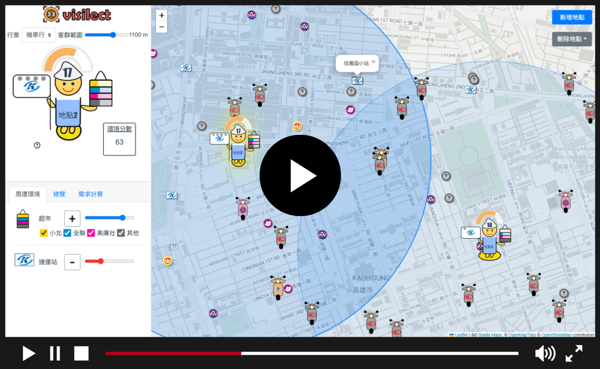
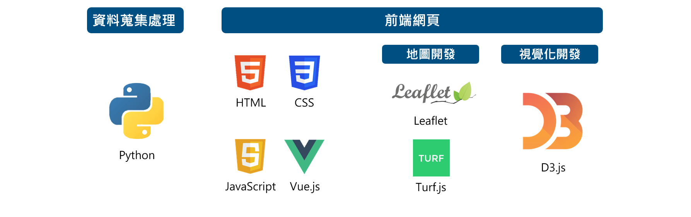

# Visilect - 企業視覺化選址系統

<blockquote style="background-color: #f0f4f8; border: 0px; border-radius: 6px; padding: 18px 0px 5px 20px; margin: 0; color: #24292f; line-height: 1.25;">
  
> 中山大學資訊管理學系 112級畢業專題

> 資訊應用服務創新競賽 第27屆 IP3資訊應用組  第二名 

> 國科會大專學生研究計畫（計畫編號：111-2813-C-110-029-E）

> 研討會論文  
Sin-Yi Lian, Chang-Ze Li, Yi Lo, Ling-Chen Li, Guan-Pei Lin, Yi Han (2024). Visilect: A Visualization System For Business Location Selection . TSWIM 2024, Taiwan. 
</blockquote>
 

## 專案簡介
<!-- <h2 style="border-bottom: none;">專案簡介</h2> -->
選址對業者未來收益及成本影響重大，在選址時往往須同時考慮如當地人口組成、周邊交通系統、有利設施、租金成本、競爭對手位置等資訊，然上述資訊常分散於各平台，並多以數據或表格列示，可讀性低且不利於各選址地點之綜合優劣比較。 

因此， Visilect 以圖示視覺化選址地點的多項參考資訊，以便使用者判讀與進行不同地點之比較（<a href="#glyph">圖1</a>）。當使用者於系統地圖上選定開業地點後，系統將根據政府資料開放平台提供之人口資訊計算該地之潛在需求，同時根據使用者設定對選址地點有利（害）周邊設施之權重，計算該地周邊設施之綜合分數，於圖示呈現該地點之「預估潛在需求」<a href="#ref1">1</a> 、「周邊有利（害）設施與其加權評分」<a href="#ref2">2</a> 、「租金」<a href="#ref3">3</a> 及「周邊競爭者」<a href="#ref4">4</a>，並於地圖標示選址地點的周圍設施。  

  <b>圖 1</b>： Visilect 機車行選址地點圖示範例

## Demo Video
<!-- <h2 style="border-bottom: none;">Demo Video</h2> -->

* **影片剪輯**：羅頤
* **旁白錄音**：羅頤
* **腳本**：全體成員 

🔻**點擊觀看 Youtube Demo 影片** 

## Live Demo
<!-- <h2 style="border-bottom: none;">Live Demo</h2> -->
🔗 <a href="https://visilect-ali-ver.vercel.app/">https://visilect-ali-ver.vercel.app/</a>

## 開發工具
<!-- <h2 style="border-bottom: none;">開發工具</h2> -->

## 我的貢獻

### 前端開發與地理空間計算

- **前端架構與地圖建置：** 研究並導入 Vue.js 與 Leaflet，建立專案開發環境，完成初始頁面切版、地圖底圖與基礎地圖視圖，並拆分 `.vue` 元件、分配後續功能開發工作。
- **地圖視圖核心功能：** 負責地圖視圖主要功能的開發，涵蓋使用者點選地圖任意位置進行選址時的地理空間判斷、相關資料計算與 SVG 圖示生成，以及選址地點周邊建築物的圖像標記呈現。
- **地理空間計算與需求估算：** 獨立選用並整合 Turf.js，實作商圈範圍與各村里之間的地理覆蓋比例計算，結合各村里的預估需求數估算商圈潛在需求，並將計算結果整合至地圖視圖。
- **租金資訊呈現：** 負責租金相關資料的計算與前端呈現。
- **操作引導動畫：** 使用 SVG 製作系統操作引導動畫。

### 資料蒐集與前處理

- 蒐集並確認政府公開資料來源，涵蓋租金、幼兒園、捷運站、幼兒人口、機車數量、村里面積及公園等資訊。
- 參與資料整理與前處理，並協調組員分工完成專案所需資料準備。

### 專案管理與研究計畫

- **專案規劃與團隊協作：** 擔任專案組長，負責工作分配、進度追蹤與團隊問題協調，統籌研究計畫申請、競賽、畢業專題展及結案等工作。
- **研究計畫撰寫：** 提出專案初始構想，經與指導教授及團隊討論後確立研究方向；主筆國科會大專生研究計畫提案與結案報告，並處理計畫經費申請及競賽相關對外聯繫。

### 學術發表

- 以第一作者身分，在韓毅教授指導下，與組員李昌澤共同撰寫英文論文 *Visilect: A Visualization System for Business Location Selection*，發表於 TSWIM 2024。

## Reference

1 政府資料開放平台. 村里戶數、單一年齡人口. <a href="https://data.gov.tw/dataset/77132">https://data.gov.tw/dataset/77132</a>, 
&nbsp&nbsp&nbsp交通部公路總局統計查詢網. 機動車輛登記數-按行政區別分. <a href="https://stat.thb.gov.tw/hb01/webMain.aspx?sys=100&funid=11100">https://stat.thb.gov.tw/hb01/webMain.aspx?sys=100&funid=11100</a>

2 高雄市政府工務局公園處. 特色公園地圖. <a href="https://pwbpo.kcg.gov.tw/News_Photo.aspx?n=368FF1FBF413E73A">https://pwbpo.kcg.gov.tw/News_Photo.aspx?n=368FF1FBF413E73A</a> 
&nbsp&nbsp&nbsp交通部數據匯流平台. 高雄捷運路線車站. <a href="https://tdx.transportdata.tw/">https://tdx.transportdata.tw</a> 
&nbsp&nbsp&nbsp全聯福利中心. 門市搜尋. <a href="https://www.pxmart.com.tw/customer-service/stores/pxmart">https://www.pxmart.com.tw/customer-service/stores/pxmart</a> 
&nbsp&nbsp&nbsp小北百貨. 門市資訊. <a href="https://www.showba.com.tw/store_page?menuid=9">https://www.showba.com.tw/store_page?menuid=9</a> 
&nbsp&nbsp&nbsp美廉社. 全台門市. <a href="https://www.simplemart.com.tw/ec99/ushop20097/map.asp">https://www.simplemart.com.tw/ec99/ushop20097/map.asp</a> 
&nbsp&nbsp&nbspUbike. 站點資訊. <a href="https://www.youbike.com.tw/region/kcg/stations/list/">https://www.youbike.com.tw/region/kcg/stations/list/</a>

3 開放台灣民間租屋資料. 2020 年度資料（消除重複住宅）. <a href="https://rentalhouse.g0v.ddio.io/download/">https://rentalhouse.g0v.ddio.io/download/</a>

4 政府資料開放平台. 幼兒園名錄. <a href="https://data.gov.tw/dataset/6086">https://data.gov.tw/dataset/6086</a>